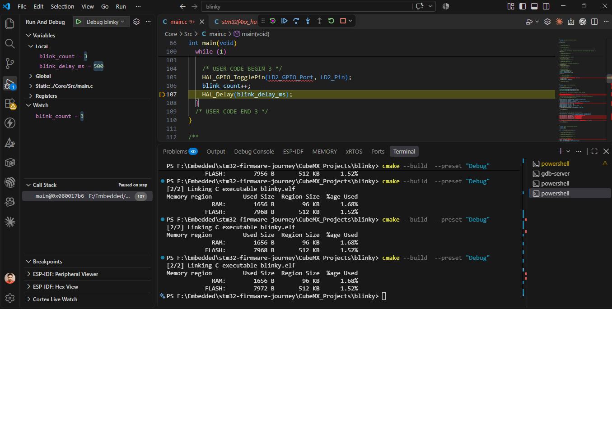

# W1 D6: Debugging blinky in VS Code

**Date:** 2026-11-07 · **Board:** NUCLEO-F401RE · **Tools:** VS Code + Cortex-Debug → arm-none-eabi-gdb → OpenOCD → ST-Link

## What I did
1. Moved `HAL_GPIO_TogglePin()` and `HAL_Delay()` between `/* USER CODE BEGIN 3 */` and `/* USER CODE END 3 */` so CubeMX regeneration keeps them.
2. Set a breakpoint on the toggle line, pressed F5, and stepped with F10.
3. Added two variables in USER CODE sections:
   - `uint32_t blink_count`: incremented on every toggle.
   - `uint32_t blink_delay_ms = 500`: passed to `HAL_Delay()`.
4. Tracked `blink_count` in the Watch panel.
5. Changed `blink_delay_ms` to 100 with Variables → right-click → Set Value, then continued.

## What I learned
- **A breakpoint stops before its line runs.** Stopped on the toggle line, the LED had not changed; it changed only after F10.
- **F10 runs the whole function.** F10 on `HAL_Delay(500)` took ~500 ms and stopped back at the top of the loop.
- **F11 goes inside.** F11 on `HAL_Delay` opened it in `stm32f4xx_hal.c`.
- **`HAL_Init()` runs once,** before `while(1)`. The loop never goes back to it.
- **Prediction check:** with the breakpoint on the toggle line and `blink_count++` after it, the 3rd stop shows **2**. Watch confirmed it.
- **Panels only update when the CPU is halted.** VS Code asks GDB for values at each halt; while running, nothing is read.
- **Set Value changes RAM only.** 100 ms worked immediately, but a reset brought back 500, because the starting value comes from flash. To make it permanent: edit, rebuild, flash.

## What broke and how I fixed it
| Problem | Cause | Fix |
| --- | --- | --- |
| Toggle + delay outside the USER CODE markers | Misread "inside" as "comment them out" | Normal code between BEGIN 3 and END 3 |
| Expected F10 on `HAL_Delay` to stop at `HAL_Init()` | Forgot `HAL_Init()` is before the loop | F10 stops on the next line in the loop |

## Next
W1 D7: README "My build and debug setup", glossary, Week 1 self-check.
